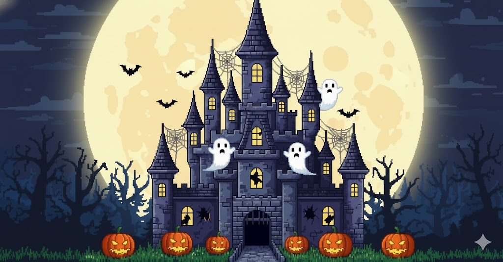
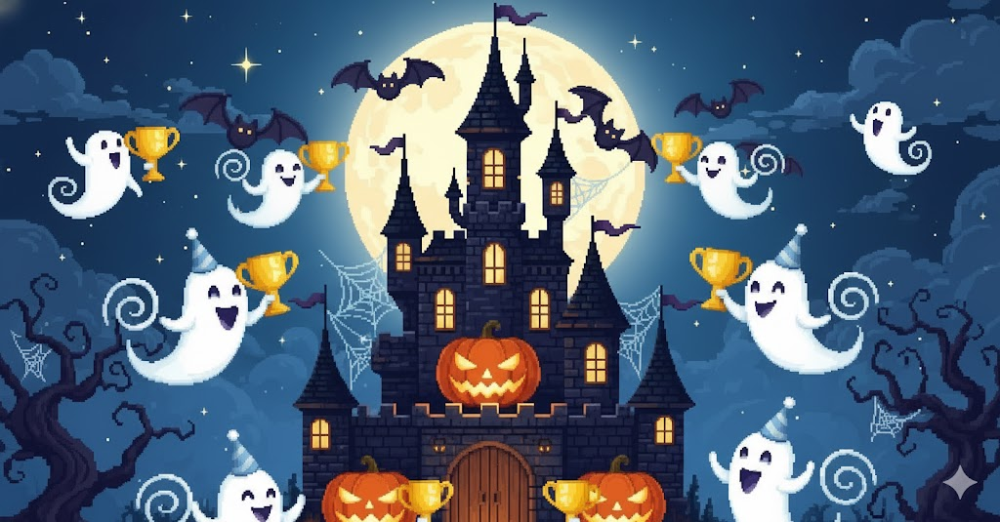
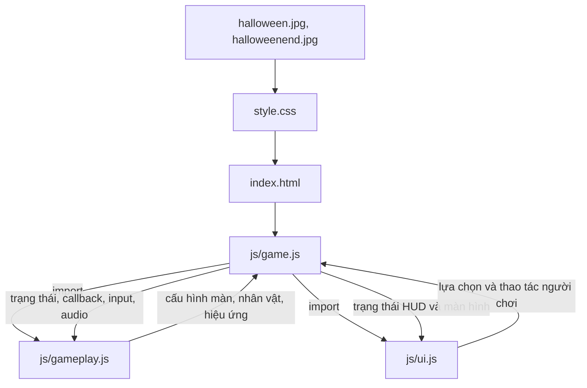
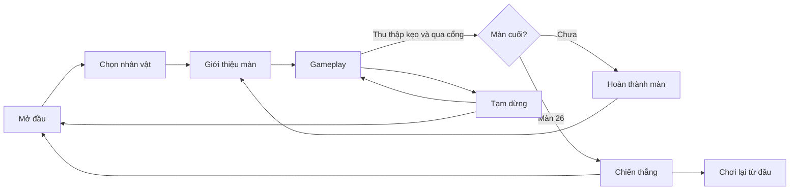

# Bóng Ma Halloween — Halloween Remaster

Game Halloween pixel-art chạy trên trình duyệt, được xây dựng bằng HTML5, CSS3 và JavaScript thuần. Người chơi chọn một trong bốn nhân vật, thu thập kẹo, né và đóng băng ma, rồi vượt qua tối đa **26 màn chơi** để đến màn kết thúc đặc biệt.

> Game sử dụng JavaScript ES Modules, vì vậy hãy chạy bằng máy chủ HTTP cục bộ hoặc hosting tĩnh. Không mở `index.html` trực tiếp bằng `file://`.

## Mục lục

- [Tính năng](#tính-năng)
- [Ảnh nền](#ảnh-nền)
- [Bắt đầu nhanh](#bắt-đầu-nhanh)
- [Cách chơi](#cách-chơi)
- [Nhân vật và màn chơi](#nhân-vật-và-màn-chơi)
- [Kiến trúc source](#kiến-trúc-source)
- [Lưu trữ dữ liệu](#lưu-trữ-dữ-liệu)
- [Kiểm thử](#kiểm-thử)
- [Giới hạn đã biết](#giới-hạn-đã-biết)
- [Khắc phục sự cố](#khắc-phục-sự-cố)
- [Đóng góp và phát hành](#đóng-góp-và-phát-hành)
- [Tác giả và cộng tác](#tác-giả-và-cộng-tác)
- [Giấy phép](#giấy-phép)

## Tính năng

- **26 màn chơi:** độ khó, tốc độ ma, số kẹo, ma phụ và mạng nhện tăng theo tiến trình; màn 26 là chặng cuối, không có màn 27.
- **Bốn nhân vật pixel-art:** Ghost Kid, Pumpkin Boy, Witch Cat và Vampire; nhân vật được chọn dùng xuyên suốt lượt chơi.
- **Điều khiển đa dạng:** bàn phím, chạm/vuốt, nhấp điểm đến và kéo trực tiếp nhân vật.
- **Cơ chế gameplay:** ma đuổi theo, nhìn về phía ma ở cự ly gần để đóng băng, thu thập kẹo, mạng nhện, vật phẩm và cổng dịch chuyển.
- **Điểm và combo kẹo:** điểm trong màn, tổng điểm và phần thưởng combo được thể hiện trong HUD.
- **Giao diện trò chơi:** intro, chọn nhân vật, giới thiệu màn, HUD, tạm dừng, hoàn thành màn, cài đặt, hướng dẫn, thành tích và chiến thắng cuối.
- **Âm thanh tổng hợp:** hiệu ứng và nhạc nền được tạo bằng Web Audio API; không cần tải tệp âm thanh riêng.
- **Responsive:** bố cục hỗ trợ màn hình máy tính và thiết bị cảm ứng; game tự cập nhật kích thước khi cửa sổ thay đổi.
- **Tạm dừng an toàn:** game tự tạm dừng khi cửa sổ mất focus hoặc trang bị ẩn.
- **Không cần backend, framework, engine hay bước cài dependency.**

## Ảnh nền

Hai ảnh dưới đây được dùng làm nền cho màn hình mở đầu và màn hình chiến thắng. Đây là tài nguyên giao diện, không phải ảnh chụp màn hình gameplay.

| Màn hình    | Tài nguyên                                    |
| ----------- | --------------------------------------------- |
| Mở đầu      |       |
| Chiến thắng |  |

Ảnh chụp riêng của gameplay và màn hình chọn nhân vật hiện chưa được cung cấp.

## Bắt đầu nhanh

### Yêu cầu

- Trình duyệt hiện đại có hỗ trợ JavaScript ES Modules và Web Audio API.
- Python 3 để chạy máy chủ HTTP cục bộ (hoặc dùng một máy chủ tĩnh tương đương).
- Kết nối Internet chỉ cần thiết để tải font Pixelify Sans và IBM Plex Mono từ Google Fonts. Nếu ngoại tuyến, game dùng font dự phòng.

### Chạy trên máy tính

Mở PowerShell tại thư mục dự án:

```powershell
python -m http.server 8000
```

Sau đó truy cập <http://localhost:8000>. Dừng máy chủ bằng `Ctrl+C`.

Nếu lệnh `python` không có trên máy, thử:

```powershell
py -m http.server 8000
```

### Chạy bằng VS Code

Mở thư mục dự án trong VS Code, khởi động một tiện ích máy chủ tĩnh (ví dụ Live Server) tại thư mục gốc rồi mở URL localhost mà tiện ích cung cấp. Không mở tệp bằng đường dẫn `file://`.

### Triển khai hosting tĩnh

Đưa toàn bộ thư mục dự án lên dịch vụ hosting tĩnh, giữ nguyên cấu trúc thư mục và tên tệp. Máy chủ phải phục vụ JavaScript ES Modules; không cần API hay cấu hình backend.

## Cách chơi

1. Chọn **Bắt đầu chơi**, sau đó chọn nhân vật và xác nhận.
2. Xem giới thiệu màn và nhấn **Vào màn chơi**.
3. Thu thập đủ kẹo để mở cổng dịch chuyển. Đi qua cổng để hoàn thành màn.
4. Dùng nút tạm dừng để tiếp tục, chơi lại màn hoặc về màn hình chính.
5. Hoàn thành màn 26 để xem hoạt cảnh chiến thắng. Có thể chơi lại, xem thành tích hoặc về màn hình chính.

### Điều khiển

| Hành động               | Điều khiển                                                          |
| ----------------------- | ------------------------------------------------------------------- |
| Di chuyển               | Phím mũi tên hoặc `W`, `A`, `S`, `D`                                |
| Di chuyển theo điểm đến | Nhấp/chạm vào vị trí trong khu vực chơi                             |
| Kéo nhân vật            | Nhấn giữ hoặc chạm giữ nhân vật rồi kéo đến vị trí an toàn          |
| Tạm dừng / tiếp tục     | Nút `Ⅱ`, `P` hoặc `Escape`                                          |
| Đóng băng ma            | Quay mặt về phía ma khi ở đủ gần; theo dõi thanh đóng băng trên HUD |

Mạng nhện làm chậm người chơi và có thể khiến người chơi mất kẹo. Trên điện thoại, nên xoay ngang nếu giao diện hoặc khu vực chơi quá chật.

## Nhân vật và màn chơi

### Nhân vật

| Nhân vật    | Mô tả                                               |
| ----------- | --------------------------------------------------- |
| Ghost Kid   | Ma nhỏ tinh nghịch, áo choàng sáng màu và mũ fez đỏ |
| Pumpkin Boy | Bí ngô cam với cuống xanh và gương mặt cười         |
| Witch Cat   | Mèo phù thủy tím với tai nhọn và mũ phép thuật      |
| Vampire     | Ma cà rồng nhí với áo choàng đỏ rượu và nanh nhỏ    |

Mỗi nhân vật có tạo hình pixel mask riêng. Việc chọn nhân vật không thay đổi kích thước/hitbox gameplay.

### Tiến trình màn chơi

Cấu hình 26 màn được tập trung trong `LEVELS` ở [js/gameplay.js](./js/gameplay.js). Các màn được chia thành sáu chủ đề:

| Màn   | Chủ đề                   |
| ----- | ------------------------ |
| 1–5   | Nghĩa địa trăng non      |
| 6–10  | Vườn bí ngô phát sáng    |
| 11–15 | Rừng kẹo phù thủy        |
| 16–20 | Lâu đài ma trăng tím     |
| 21–25 | Đêm hội Halloween        |
| 26    | Dạ tiệc bí ngô cuối cùng |

Số kẹo, ma phụ, mạng nhện và tốc độ ma được giới hạn trong cấu hình để độ khó tăng dần mà không sinh số lượng đối tượng không kiểm soát. Sau cổng màn 26, game chuyển sang trạng thái hoàn thành; không tạo màn 27.

## Kiến trúc source

```text
.
├── index.html
├── style.css
├── halloween.jpg
├── halloweenend.jpg
└── js/
    ├── game.js
    ├── gameplay.js
    └── ui.js
```



- **`js/game.js`** — entry point duy nhất; điều phối trạng thái game, vòng lặp `requestAnimationFrame`, bàn phím/Pointer Events, tạm dừng khi ẩn tab và Audio Manager dựa trên Web Audio API.
- **`js/gameplay.js`** — định nghĩa nhân vật và cấu hình màn; quản lý di chuyển, AI ma, va chạm, kẹo, mạng nhện, vật phẩm, cổng và tiến trình.
- **`js/ui.js`** — dựng màn hình chọn nhân vật, HUD, modal, cài đặt, thông báo, thành tích và màn chiến thắng; lưu một số tùy chọn bằng `localStorage`.
- **`index.html`** — cấu trúc DOM và entry point module.
- **`style.css`** — giao diện, bố cục responsive, hoạt ảnh và hiệu ứng pixel-art.

Sơ đồ luồng chơi:



## Lưu trữ dữ liệu

Game lưu tùy chọn trong `localStorage` của trình duyệt:

- Nhân vật đã chọn (`halloweenCharacter`).
- Tên người chơi và tên bóng ma.
- Trạng thái bật/tắt âm thanh (`halloweenMuted`).

Điểm và thành tích chỉ thuộc lượt chơi hiện tại; hiện chưa có bảng xếp hạng hoặc lưu hồ sơ thành tích dài hạn. Xóa dữ liệu trang web trong trình duyệt sẽ xóa các tùy chọn đã lưu.

## Kiểm thử

Các kiểm tra thủ công đã thực hiện trong trình duyệt tích hợp:

- Khởi động game, chọn nhân vật và vào gameplay.
- Thử điều khiển bằng điểm chạm/kéo, tạm dừng và tiếp tục.
- Thử cập nhật tên trong cài đặt.
- Kiểm tra cú pháp JavaScript của các module.
- Mô phỏng tiến trình qua 26 màn; xác nhận màn cuối hiển thị chiến thắng và không chuyển sang màn 27.

Đây là kiểm tra trong trình duyệt tích hợp, không phải xác nhận đã thử trên mọi trình duyệt, kích thước màn hình hoặc thiết bị vật lý.

## Giới hạn đã biết

- Vật phẩm tăng tốc và nam châm có logic gameplay. Vật phẩm có biểu tượng tim/repel hiện chưa có tác dụng đẩy ma hoàn chỉnh; không nên xem đây là cơ chế bảo vệ đang hoạt động.
- Thành tích chỉ được tính trong phiên chơi hiện tại và không lưu sau khi tải lại trang.
- Âm thanh có thể chỉ phát sau tương tác đầu tiên của người chơi, tùy chính sách autoplay của trình duyệt.
- Font từ Google Fonts cần mạng; khi không có mạng sẽ dùng font dự phòng.
- Chưa có ảnh chụp màn hình riêng cho gameplay/chọn nhân vật và chưa có bộ kiểm thử tự động trong dự án.

## Khắc phục sự cố

| Hiện tượng                         | Cách xử lý                                                                                                        |
| ---------------------------------- | ----------------------------------------------------------------------------------------------------------------- |
| Trang trắng hoặc lỗi import module | Chạy qua HTTP server; không dùng `file://`. Kiểm tra console và bảo đảm giữ nguyên cấu trúc thư mục `js/`.        |
| Không tải được font                | Kiểm tra mạng; game vẫn có font dự phòng nếu Google Fonts không truy cập được.                                    |
| Chưa nghe thấy âm thanh            | Tương tác với game trước để cho phép trình duyệt kích hoạt Web Audio; kiểm tra nút âm thanh và âm lượng thiết bị. |
| Cài đặt không được giữ lại         | Bật lưu trữ trang web/localStorage trong trình duyệt và không dùng chế độ duyệt web riêng tư bị giới hạn lưu trữ. |
| Điều khiển bàn phím không phản hồi | Nhấp vào khu vực game trước; tránh để con trỏ đang nhập trong ô tên/cài đặt.                                      |
| Port 8000 đang được sử dụng        | Chạy `python -m http.server 8001` rồi mở `http://localhost:8001`.                                                 |

## Đóng góp và phát hành

Không cần cài package để chạy dự án. Khi chỉnh sửa:

1. Giữ nguyên vanilla JavaScript và ba module gameplay/UI/điều phối hiện tại.
2. Kiểm tra đường dẫn tương đối trong `index.html`, CSS và imports.
3. Chạy bằng HTTP server và thử các luồng chính: chọn nhân vật, bắt đầu màn, tạm dừng, chơi lại, hoàn thành màn cuối.
4. Khi thay đổi cân bằng, chỉnh cấu hình `LEVELS` tập trung trong `js/gameplay.js`.

Trước khi phát hành công khai, hãy xác nhận quyền sử dụng và giấy phép của mọi tài nguyên hình ảnh/font được phân phối kèm.

## Tác giả và cộng tác

- **Tác giả gốc:** Nguyễn Minh.
- **Cộng tác nâng cấp/remaster:** VanhCodes - Vanh Love IT.

## Giấy phép

**Chưa được xác định.** README này không cấp quyền sử dụng, sao chép hoặc phân phối source hay tài nguyên. Hãy bổ sung giấy phép sau khi tác giả xác nhận phạm vi cấp phép và quyền đối với các tài nguyên đi kèm.
